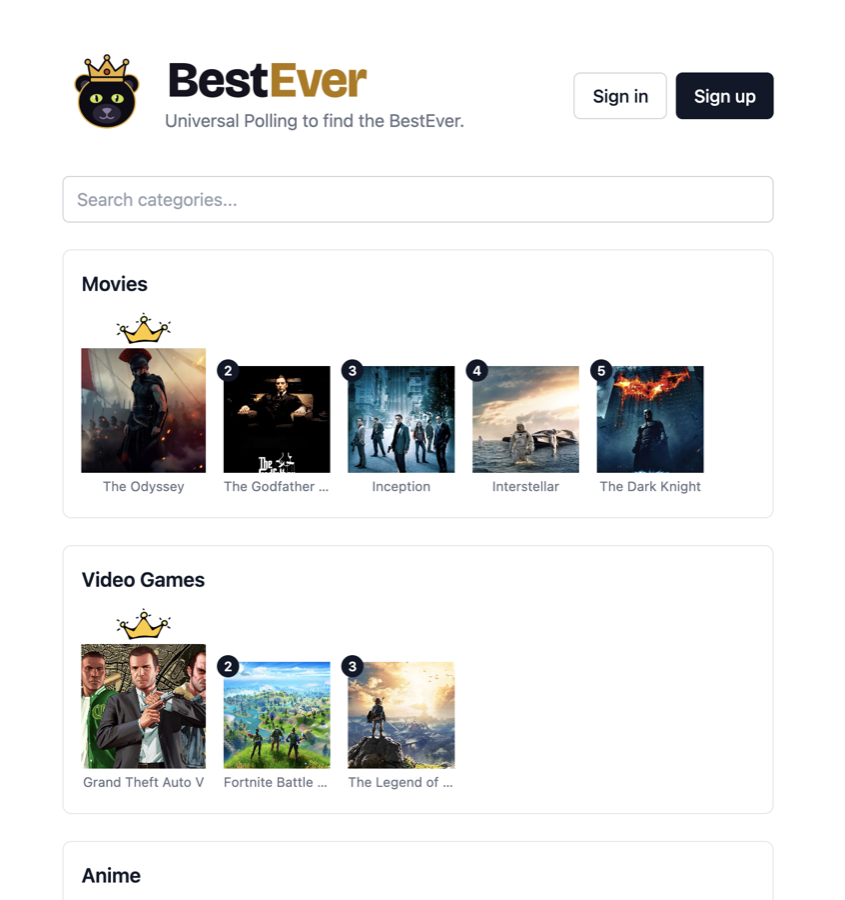

<p align="center">
  
</p>

<p align="center">
  <strong>One account. One vote per category. What's the best ever?</strong><br />
  <a href="https://bestever.live">bestever.live</a>
</p>

---

**BestEver** is a full-stack voting site. You get exactly **one vote per category**
("Best Movie Ever", "Best Video Game Ever", and so on). Search for anything through a
real external API and cast your vote. Each category has a live leaderboard with
vote counts and percentages. You can change or remove your vote at any time, but you
can never have more than one per category.



## Features

- **Four categories**: Movies, Video Games, Anime, and Actors. Each one is backed by its own external search API.
- **Live leaderboards** with the top 25 items per category, vote totals, and each item's share of the vote.
- **Cast, change, or remove your vote**, with your current pick highlighted.
- **"Find an existing vote" search** across items already in the database, so you can find something even if it isn't in the visible top 25.
- **Homepage previews** showing the top 5 of every category at a glance.
- **Accounts** with email/password or Google sign-in, plus email verification before voting.
- **Profile page** listing every vote you've cast across categories.

## Tech stack

| Layer | Tech |
|---|---|
| Frontend | React, TypeScript, Vite, Tailwind CSS, React Router |
| Backend | Node.js, Express 5, TypeScript |
| Database | PostgreSQL on **AWS RDS**, Prisma ORM |
| Auth | Firebase Authentication (client SDK + Admin SDK token verification) |
| External APIs | TMDB (movies, actors), RAWG (video games), MyAnimeList (anime) |
| Infrastructure | Docker (multi-stage build), Kubernetes manifests |
| Hosting | Vercel (frontend), Render (API) |

## Architecture

```
┌──────────────────────┐   HTTPS + Bearer token   ┌──────────────────────┐
│  client/  (Vercel)   │ ───────────────────────▶ │  server/  (Render)   │
│  React SPA           │                          │  Express REST API    │
│  Firebase JS SDK     │                          │  Firebase Admin SDK  │
└──────────────────────┘                          └──────────┬───────────┘
                                                             │ Prisma
                                     ┌───────────────────────┼─────────────────────┐
                                     ▼                       ▼                     ▼
                              ┌─────────────┐     ┌─────────────────────┐   ┌────────────┐
                              │ PostgreSQL  │     │ TMDB · RAWG · MAL   │   │  Firebase  │
                              │ (AWS RDS)   │     │ (external search)   │   │  Auth      │
                              └─────────────┘     └─────────────────────┘   └────────────┘
```

The repo is a monorepo with **two fully independent services**: no shared code and no
monorepo tooling. They talk only over HTTP, so each can be containerized, deployed,
and scaled on its own.

- **`client/`** is a static single-page app. It handles sign-up and sign-in directly
  with Firebase, then sends the Firebase ID token to the API as
  `Authorization: Bearer <token>`.
- **`server/`** is a plain Express API (deliberately not a framework abstraction like
  Next.js or NestJS). It never sees a password. It only *verifies* Firebase ID tokens
  using the Admin SDK.

I chose a separate Express server over a serverless full-stack framework on purpose:
a long-running `app.listen()` process maps directly onto Docker containers and
Kubernetes Deployments, which was a core goal of the project.

## Design decisions

### One vote per category, enforced by the database

The core rule of the product lives in the schema, not just in route logic:

```prisma
model Vote {
  userId     String
  categoryId String
  itemId     String
  @@unique([userId, categoryId])
}
```

Even a buggy or racing request can't create a second vote in the same category,
because Postgres rejects it. The API catches Prisma's unique-violation error (`P2002`)
and turns it into a `409 Conflict`. Changing a vote is a separate `PUT` that repoints
the existing row rather than creating a new one.

### Denormalized vote counter

`Item.voteCount` is a stored counter, not a `COUNT(*)` over the `Vote` table. Every
cast, change, or removal updates it **inside a transaction** together with the
`Vote` row, so the two can never drift apart:

- **Cast**: create the vote, then increment the item.
- **Change**: repoint the vote, decrement the old item, then increment the new item.
- **Remove**: delete the vote, then decrement the item.

This is the classic read-versus-write tradeoff. Leaderboards are read far more often
than votes are written, so paying a little extra on writes makes every leaderboard
read a simple indexed `ORDER BY voteCount`.

The **category total** is deliberately *not* denormalized. It's read once per page
load, not once per item, so a plain `COUNT` is already cheap. Adding a third write to
every vote transaction would add complexity with no real benefit at this scale.

### No duplicate items from external APIs

`Item` has a unique constraint on `[categoryId, externalId]`. When someone votes for
a search result, the API **upserts** on that key, so the same TMDB movie picked by a
thousand users is one row with a thousand votes, not a thousand rows that split the
count.

### External APIs fail soft

Each category maps to a provider module behind a shared `ExternalSearchResult` shape
(`server/src/external/registry.ts`), so adding a category means adding one module.
A slow or broken provider returns "no results" instead of an error, and voting
itself never depends on an external API being up.

Some providers needed extra work:

- **MyAnimeList's** search endpoint has no sort parameter, so obscure exact-title
  matches outranked hugely popular shows. The server requests MAL's `popularity`
  rank and re-sorts results itself.
- **TMDB** returns relative image paths that need a CDN prefix. RAWG and MAL return
  full URLs. Each provider module normalizes this away.

### Auth: outsourced on purpose, verified on the server

Password storage, password resets, rate limiting, and breach detection are easy to get
wrong, so credentials live in Firebase. The server's job is narrower:

1. **`requireAuth`** verifies the ID token and attaches the user's Firebase UID,
   email, and email-verified status to the request.
2. **`requireVerifiedEmail`** blocks voting and item creation until the email is
   verified. It's kept as a **separate** middleware because some authenticated routes
   (like syncing a brand-new user right after sign-up) must work *before*
   verification is possible.

Routes follow a consistent middleware chain:

```
cors (explicit origin allowlist) → express.json() → requireAuth → requireVerifiedEmail → handler
```

CORS uses an explicit origin allowlist instead of allowing every origin.

### Container-ready from the start

- `server/Dockerfile` is a **multi-stage build**. The first stage installs dev
  dependencies, generates the Prisma client, and compiles TypeScript. The final image
  contains only production dependencies and compiled JavaScript.
- No secrets are baked into the image. Every credential, including the Firebase
  service account, which is split into three env vars, is injected at runtime.
- `GET /health` exists for Kubernetes readiness and liveness probes, used by the
  manifests in `server/k8s/`.

## Data model

```
User ──< Vote >── Item
          │         │
          └──> Category <──┘
```

| Model | Purpose |
|---|---|
| `User` | Links to a Firebase identity through a unique `firebaseUid` |
| `Category` | Movies, Video Games, etc., addressed by `slug` |
| `Item` | Something you can vote for, with an optional `externalId` + `imageUrl` and a denormalized `voteCount` |
| `Vote` | One per `(user, category)`, pointing at an `Item` |

## API

| Method | Route | Auth | Description |
|---|---|---|---|
| `GET` | `/health` | — | Liveness/readiness probe |
| `GET` | `/categories` | — | List all categories |
| `GET` | `/categories/:slug/leaderboard` | — | Top 25 items by vote count |
| `GET` | `/categories/:slug/total-votes` | — | Total votes cast in the category |
| `GET` | `/categories/:slug/search?q=` | — | Search the category's external API |
| `GET` | `/categories/:slug/items?q=` | — | Search items already in the database |
| `GET` | `/categories/:slug/my-vote` | 🔒 | The signed-in user's vote in this category |
| `POST` | `/categories/:slug/items` | 🔒✉️ | Find-or-create an item |
| `POST` | `/vote` | 🔒✉️ | Cast a vote (`409` if one already exists) |
| `PUT` | `/vote` | 🔒✉️ | Change your vote in a category |
| `DELETE` | `/vote/:categoryId` | 🔒 | Remove your vote |
| `POST` | `/users/sync` | 🔒 | Create/update the user row after sign-in |
| `GET` | `/me/votes` | 🔒 | All of the signed-in user's votes |

🔒 = valid Firebase ID token required · ✉️ = verified email also required

## Project structure

```
.
├── client/                 React SPA (deployed to Vercel)
│   ├── src/
│   │   ├── api/            fetch wrappers for each API resource
│   │   ├── components/     SearchBox, auth forms, Modal, CategoryTopFive
│   │   ├── pages/          Home, CategoryPage, ProfilePage, NotFound
│   │   └── lib/firebase.ts Firebase client setup
│   └── vercel.json         SPA rewrite so client-side routes survive refresh
│
└── server/                 Express API (deployed to Render)
    ├── src/
    │   ├── routes/         categories, votes, users, me
    │   ├── middleware/     requireAuth, requireVerifiedEmail
    │   ├── external/       one module per search provider + registry
    │   └── lib/            Prisma client, Firebase Admin setup
    ├── prisma/             schema, migrations, seed script
    ├── k8s/                Deployment + Service manifests
    └── Dockerfile          multi-stage production image
```

## Running locally

**Prerequisites:** Node.js 20+, a PostgreSQL database, a Firebase project (with
Email/Password and Google sign-in enabled), and API keys for TMDB, RAWG, and
MyAnimeList (all free).

### 1. Server

```bash
cd server
cp .env.example .env        # fill in DATABASE_URL, API keys, Firebase service account values
npm install
npx prisma migrate deploy --config prisma7.config.ts
npx prisma db seed --config prisma7.config.ts
npm run dev                 # http://localhost:4000
```

### 2. Client

```bash
cd client
cp .env.example .env        # fill in your Firebase web app config; VITE_API_URL defaults to localhost:4000
npm install
npm run dev                 # http://localhost:5173
```

### Docker (server)

```bash
cd server
docker build -t bestever-server .
docker run -p 4000:4000 --env-file .env bestever-server
```

> Docker's `--env-file` is stricter than `dotenv`: values must be on one line with
> no surrounding quotes. Keep `FIREBASE_PRIVATE_KEY`'s newlines as literal `\n`.

## Roadmap

- [ ] Dockerize the client (static build served by nginx)
- [ ] `docker-compose.yml` to run both services together
- [ ] Run the full stack on a local Kubernetes cluster, then a managed one (EKS)
- [ ] Show existing vote counts directly on external search results
- [ ] More categories (Musical Artists, Places)
